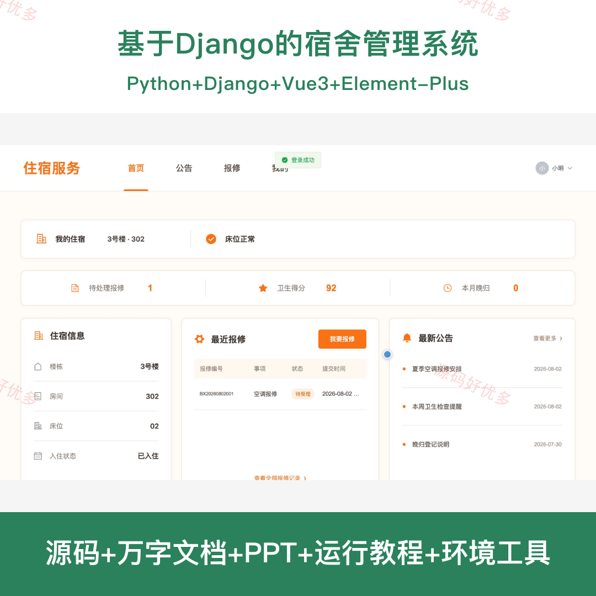
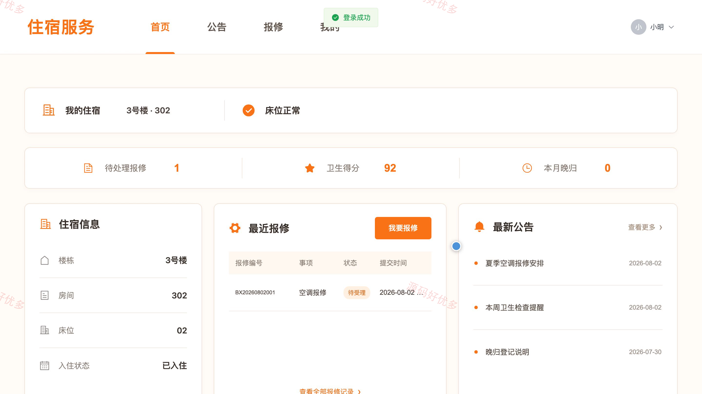
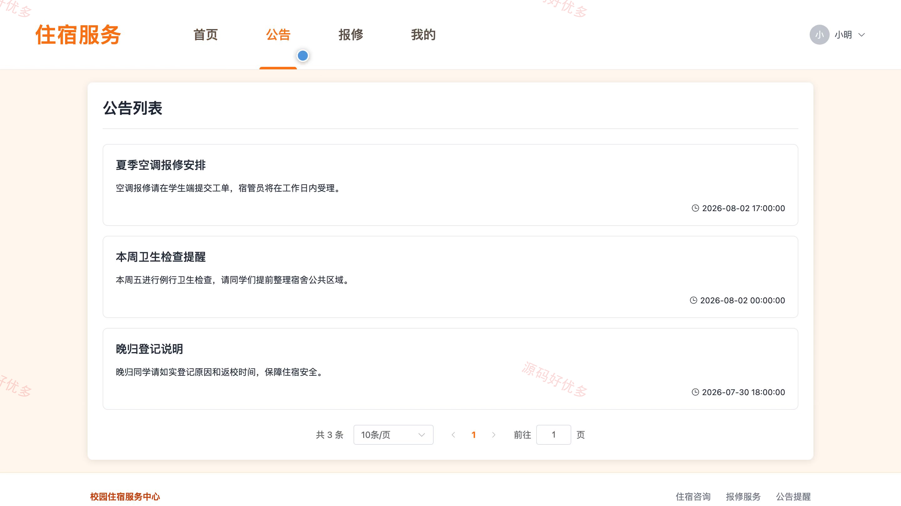
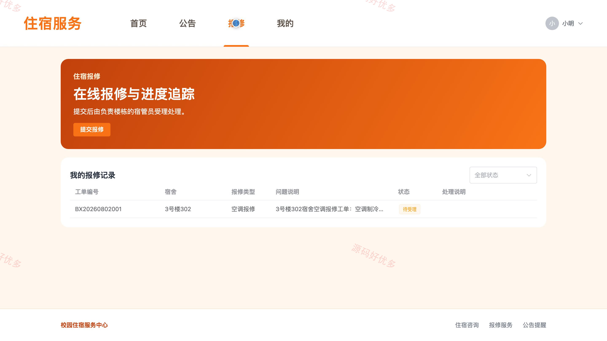
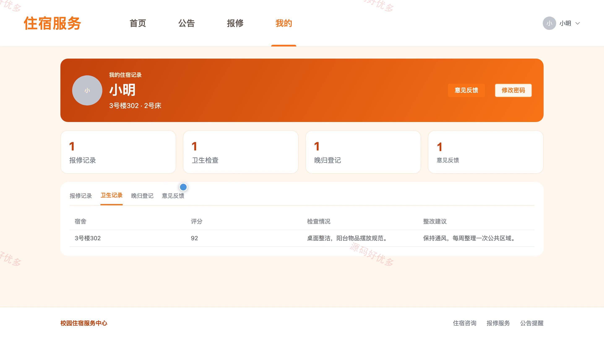
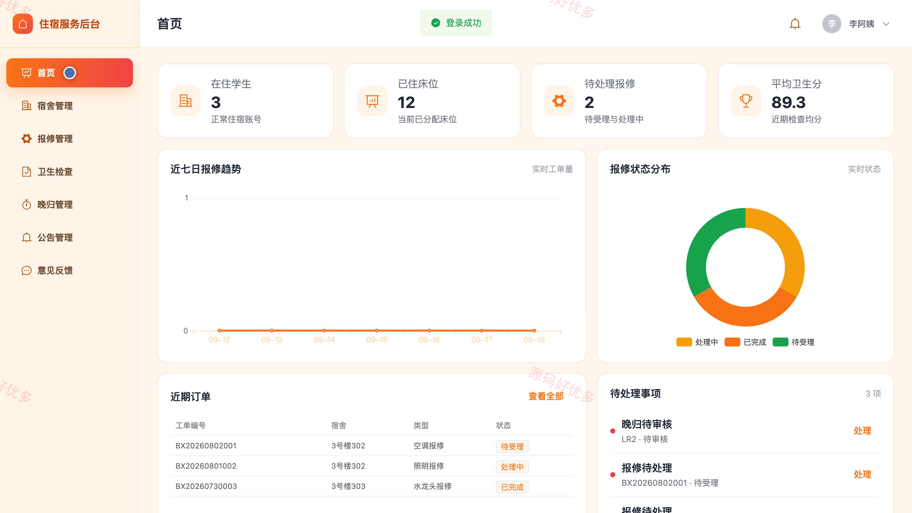
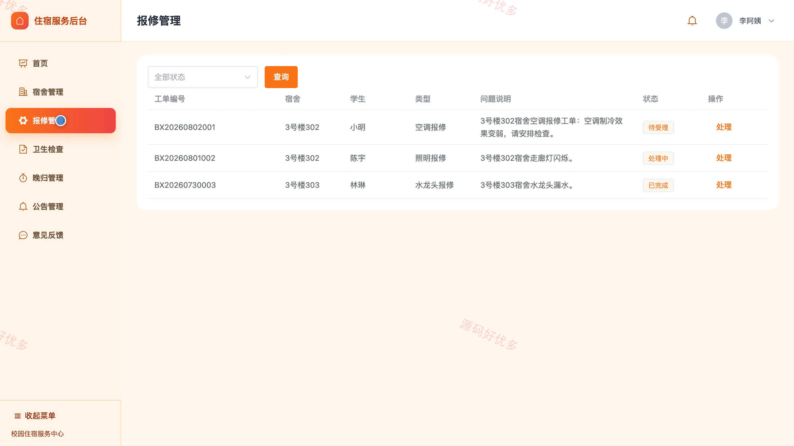
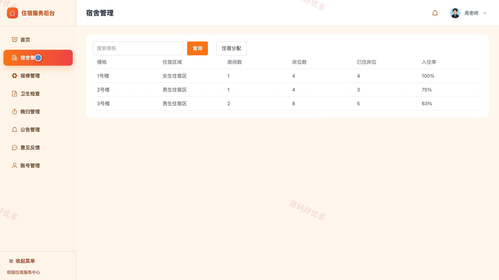
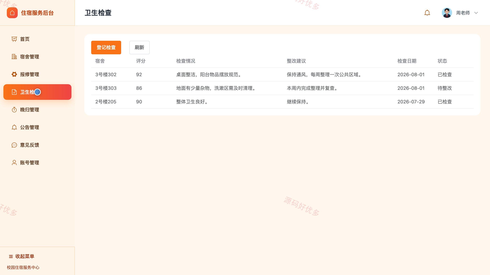

# bs017C
bs017C基于Django的宿舍管理系统源码 Python Django Vue3 前后分离
## 源码问题查看主页咨询

### 一、关键词
宿舍管理、住宿分配、在线报修、卫生检查、晚归管理

### 二、作品包含
源码+数据库+万字设计文档+PPT+全套环境和工具资源+本地部署教程

### 三、项目技术
前端技术： Html、Css、Js、Vue3.4、Element-Plus
后端技术：Python、Django

### 四、运行环境要求
开发工具：PyCharm + VSCODE

数据库：MySQL5.7+（共11张表）

数据库管理工具：Navicat10以上版本

环境配置软件： Python3+

前端Nodejs：16+

浏览器：谷歌浏览器

### 五、项目介绍
项目编号：bs017C

系统面向学生、宿管员与管理员，围绕学生住宿、宿舍报修、卫生检查、晚归登记、公告及意见反馈等宿舍业务实现分角色管理。

角色：学生、宿管员、管理员

学生功能：查看住宿信息、浏览住宿公告、提交报修并跟踪进度、查看卫生检查、登记与查看晚归记录、提交意见并查看回复、修改个人密码。

宿管员功能：查看宿舍业务看板、查看楼栋与宿舍、受理并更新报修工单、登记卫生检查、查看晚归记录、发布与管理公告、回复学生意见、维护个人信息。

管理员功能：查看宿舍业务看板、管理楼栋宿舍与住宿分配、管理报修工单、管理卫生检查、管理晚归记录、管理住宿公告、回复学生意见、管理系统账号。

### 六、运行截图

